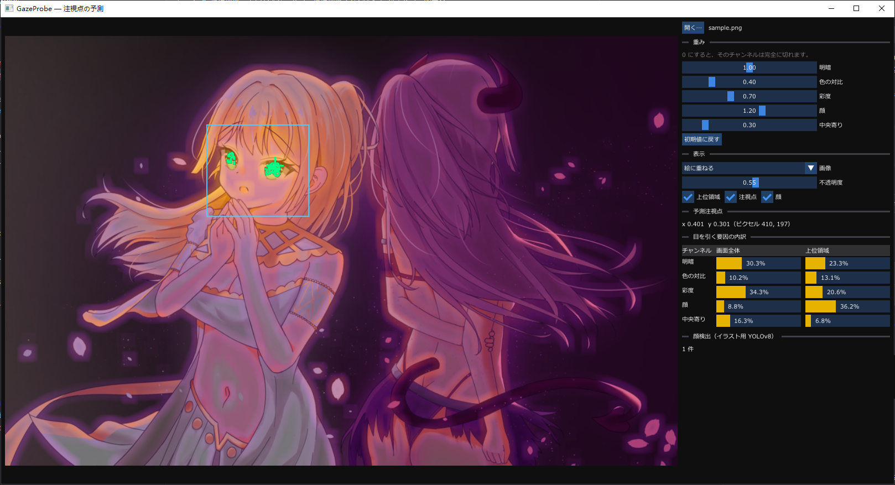

# GazeProbe

イラストを読み込み、見る人の視線が最初に向かう位置（注視点）を予測して、「何が目を引いているのか」を 5 つの要因に分けて示すツールです。

C++17 / Direct3D 11 / Dear ImGui / ONNX Runtime　・　Windows



*自作のイラストに、顕著性マップ・予測注視点（緑の十字）・上位領域（緑の輪郭）・検出した顔（青の枠）を重ねた画面。*

## 機能

- **5 チャンネルの顕著性マップ**：明暗・色の対比・彩度・顔・中央寄り
- **予測注視点と上位領域**の表示
- **目を引く要因の内訳**：各チャンネルが画面全体と上位領域にどれだけ寄与しているかを百分率で表示
- **重みの調整**：チャンネルごとのスライダーで重みを変えると、結果がその場で更新されます。チャンネルマップは画像ごとに一度だけ計算し、スライダー操作では合成だけをやり直します
- **顔検出**：イラスト向けの YOLOv8 モデルを ONNX Runtime で実行します。モデルがなくても、顔以外の 4 チャンネルは動作します
- **表示の切り替え**：絵に重ねる／顕著性マップ／チャンネル単体
- **CLI 版**：同じ解析を行い、結果をテキストと PNG で出力します

## 仕組み

1. **読み込み**：長辺 1024 px に縮小し、透明部分は白の背景に合成します。
2. **色空間の変換**：sRGB を Oklab に変換します。L が明度、(a, b) が色を表します。
3. **チャンネルの計算**

   | チャンネル | 計算 | 意味 |
   |---|---|---|
   | 明暗 | L の局所標準偏差（窓は長辺の 2%） | 周囲と比べた明度の変化。輪郭や描き込みの密な所で強くなる |
   | 色の対比 | 画素の (a, b) と、周囲の平均色（σ = 長辺の 6% のガウシアン）との距離 | 周囲の色からの離れ具合。色相の違いと彩度の違いの両方を含む |
   | 彩度 | √(a² + b²) | 色そのものの鮮やかさ。周囲には依存しない |
   | 顔 | 検出した顔の枠の中心に置いた、枠の半分の幅を σ とするガウシアン | 人は絵の中の顔をまず見る |
   | 中央寄り | 画面中央を頂点とするガウシアン | 人は画面の中央から見始める傾向がある |

4. **合成**：単位の異なるチャンネルを足し合わせられるよう、各チャンネルの 2〜99.9 パーセンタイルを [0, 1] に引き伸ばします（顔は初めから [0, 1] なのでそのまま）。これを重み付きで合計し、[0, 1] に正規化します。

   | 明暗 | 色の対比 | 彩度 | 顔 | 中央寄り |
   |---|---|---|---|---|
   | 1.0 | 0.4 | 0.7 | 1.2 | 0.3 |

5. **注視点**：合計がピークの 90% 以上になる範囲を上位領域とし、4 近傍で連結した塊に分けます。そのうち値の合計が最も大きい塊の重心を注視点とします。全体の平均をとらないのは、顔が二つあると注視点がその間の何もない所に落ちてしまうためです。
6. **内訳**：合計は各チャンネルの線形和なので、それぞれの寄与を正確に取り出せます。

> 既定の重みは仮説です。視線計測のデータに合わせて調整・検証したものではありません。

## ビルド

**必要なもの**

- Windows 10 以降
- Visual Studio 2019 以降（「C++ によるデスクトップ開発」）
- CMake 3.16 以降
- 初回の構成時のみインターネット接続（ONNX Runtime、Dear ImGui、顔検出モデル 45 MB をダウンロードします）

```
cmake -S . -B build
cmake --build build --config Release
cd build
ctest -C Release
```

実行ファイルは `build/Release/` にできます。`onnxruntime.dll` と `models/` は、ビルド時に実行ファイルの隣へコピーされます。モデルのダウンロードに失敗した場合は警告を出して続行し、顔チャンネルだけが無効になります。

## 使い方

### ビューア（`gazeprobe_viewer.exe`）

- 画像をウィンドウにドラッグ＆ドロップするか、「開く…」から選びます。コマンドライン引数で画像のパスを渡すこともできます。
- PNG・JPEG・BMP・GIF・TIFF など、WIC で読める形式に対応しています。

### CLI（`gazeprobe.exe`）

```
gazeprobe <画像> [出力プレフィックス] [--model <顔検出モデル.onnx>]
```

注視点・検出した顔・内訳を標準出力に表示し（英語）、次の PNG を書き出します。プレフィックスを省略すると、入力ファイル名をもとにカレントディレクトリへ出力します。

| ファイル | 内容 |
|---|---|
| `<prefix>_overlay.png` | 絵に顕著性マップ・顔・上位領域・注視点を重ねたもの |
| `<prefix>_heat.png` | 顕著性マップ |
| `<prefix>_contrast.png` ほか 5 枚 | チャンネルごとのマップ（contrast / colour / chroma / face / centre） |

## 構成

| ファイル | 内容 |
|---|---|
| `src/plane.h` | 画素ごとに double を持つ 2 次元配列 |
| `src/oklab.*` | sRGB → Oklab の変換 |
| `src/filters.*` | ボックスフィルタ、ガウシアン、リサイズ、局所標準偏差 |
| `src/saliency.*` | 各チャンネル、合成、上位領域、注視点、内訳 |
| `src/faces.*` | レターボックス、ONNX Runtime による推論、NMS |
| `src/image_io.*` | WIC による画像の読み書き |
| `src/*_utils.*` | 共通の小さな関数（画素値の丸め、オーバーレイの描画、計時など） |
| `src/main.cpp` | CLI |
| `src/viewer_main.cpp` `src/viewer.*` | ビューアのウィンドウと画面 |
| `src/renderer.*` | Direct3D 11 のデバイス、スワップチェーン、テクスチャ |
| `src/labels_ja.*` | UI の日本語の用語 |
| `tests/` | 6 つのテストプログラム、計 105 項目。Oklab は CSS Color 4 の基準値で照合しています |

## ライセンス

このリポジトリのコードは [MIT ライセンス](LICENSE)です。`docs/screenshot.png` に写っているイラストは作者の作品で、著作権は作者に帰属します（MIT ライセンスの対象外です）。

使用しているもの：

- [ONNX Runtime](https://github.com/microsoft/onnxruntime) — MIT License
- [Dear ImGui](https://github.com/ocornut/imgui) — MIT License
- 顔検出モデル [deepghs/anime_face_detection](https://huggingface.co/deepghs/anime_face_detection)（`face_detect_v1.4_s`）— MIT License
- Oklab の変換係数：Björn Ottosson, [A perceptual color space for image processing](https://bottosson.github.io/posts/oklab/)
- 顕著性マップの配色：matplotlib の inferno カラーマップ（CC0）を 5 点で近似

---

UI、テスト（`tests/`）、README は Claude Code の支援を受けて作成しました。コードレビューでは、Claude Code に疑わしい箇所を挙げさせ、それをもとに確認しました。
